# Architecture

ReproForge has a packaged Chrome extension, a synthetic demo server and an optional local companion. There is no hosted backend or database. Existing capture and deterministic test export work without the companion.

```mermaid
flowchart LR
  A[Inspected tab: actual fetch/XHR] --> B[Chrome DevTools network API]
  B --> C[Hidden devtools.html]
  C --> D[Normalize + sanitize]
  D --> E[150-record memory store]
  E --> F[React panel]
  F --> G[Developer defines expected behavior]
  G --> H[Validate + sanitize again]
  H --> I[Deterministic test template]
  I --> J[Review exact files]
  J --> K[ZIP download]
  K --> L[Developer runs Vitest]
  L --> M[Target guard]
  M --> N[Authorized local/test API]
```

## Entry points

- `apps/extension/public/manifest.json`: MV3 metadata, icons, CSP and DevTools page. Vite copies public assets to the build root.
- `devtools.html`: a bundled module creates `CaptureStore`, subscribes to `onRequestFinished` and registers the ReproForge panel. It exists for the lifetime of the inspected tab's open DevTools window.
- `panel.html`: React UI. `panel.onShown` passes the in-memory bridge to the panel window and dispatches a readiness event. The UI also checks for an already-present bridge, so either initialization order works.
- `apps/demo-api/src/server.ts`: binds Express to `127.0.0.1`, with mode selected by an environment variable. Mode switching requires restarting the process; there is no unauthenticated remote toggle.

## Capture boundary

`normalizeRequest` validates only the HAR fields it needs using Zod, then immediately sanitizes them. It filters status 400–599 and fetch/XHR resource types. When Chrome omits `_resourceType`, JSON response MIME is the fallback. Fonts, documents, images and other known non-API types are ignored.

Raw request objects are not stored. Duplicate detection uses weak object identity, not URL/body matching: distinct identical calls are real events. The bounded response-loader map stores only Chrome's body getter function for eligible records. It is pruned on eviction, clear, or after a preview is requested. Chrome itself may retain data behind those API handles; this extension cannot erase Chrome's Network log.

Known JSON responses with nonnegative content sizes up to 16 KiB may be loaded by the developer. The returned content is rechecked for size/encoding and sanitized. Getter errors and five-second timeouts yield notices. A response finishing after Clear cannot recreate a deleted record.

Page navigation preserves the bounded session. Pause ignores newly completed events, including requests begun earlier. Resume does not backfill requests completed while paused. Closing/reopening DevTools starts a fresh session. No background service worker or persistent storage is involved.

## UI state

`useSyncExternalStore` observes immutable snapshots from the capture store. Component state holds filters, selection, theme and builder inputs. Selection falls back to the first visible record when its previous record is filtered out or evicted. Errors from malformed records are contained in capture; a React error boundary handles rendering failures. Captured data is rendered as escaped text, never injected HTML.

The builder validates on each change. Expected status starts blank. The current observed status can be intentionally expected for a negative test, but requires an acknowledgment and is not represented as proof of a fix. DELETE requires separate approval. A native modal dialog provides keyboard focus confinement during export review. All generated files are inspectable before download.

## Generation boundary

`packages/test-generator` is a browser-compatible package. It validates inputs, reapplies sanitization, serializes literals with JSON escaping and emits fixed TypeScript templates. AI output is never involved. The runtime helper is shipped as reviewed source alongside each test.

The ZIP contains `regression.test.ts`, `safety.ts`, `package.json`, `tsconfig.json`, `vitest.config.ts`, `.env.example`, `.gitignore`, and `README.md`. The generated project has no dependency on this monorepo. `TEST_BASE_URL` has no default. Missing fixtures, authentication or paths cause clear configuration failures before a request is made.

Dependencies are installed at the workspace root and resolved through npm workspaces. Source packages expose TypeScript for Vite/tsx/Vitest; they are private and are not published packages.

## Build and API references

`npm run build` checks TypeScript, builds both HTML entry points, then validates packaged assets and manifest references. `npm run package` puts the contents of `dist` directly at the ZIP root. Neither command installs or publishes the extension.

Official references: [DevTools lifecycle](https://developer.chrome.com/docs/extensions/how-to/devtools/extend-devtools), [network events and body retrieval](https://developer.chrome.com/docs/extensions/reference/api/devtools/network), [MV3 CSP](https://developer.chrome.com/docs/extensions/reference/manifest/content-security-policy). The implementation uses supported callback forms in `chrome.*` for compatibility, rather than requiring the newer `browser.*` namespace.

## Optional integration architecture

```mermaid
flowchart LR
  P[DevTools panel] -->|Pairing and explicit approvals| C[Authenticated loopback companion]
  C --> W[CLI-authorized Git workspace]
  W --> R[Bounded sanitized context preview]
  R -->|Approved context only| G[Gemini structured output]
  G --> D[Validated grounded findings and exact diff]
  D -->|Stage approval| S[Temporary source snapshots]
  S -->|Execution approval| B[Bubblewrap baseline and patched checks]
  B -->|Passing report and local approval| L[Separate local Git branch]
  L -->|Push approval| H[GitHub branch]
  C -->|Issue or PR draft approval| H
```

`packages/shared/src/integrations.ts` owns browser/server contracts. `apps/extension/src/features/integrations` owns the memory-only client, settings, approval dialogs and three contextual workflow views. No provider credentials enter that bundle. The manifest permits optional loopback transport only.

`apps/companion/src/server.ts` validates sessions and approvals before routing operations. `workspace.ts` authorizes bounded source access; `ai.ts` handles Gemini schemas and evidence grounding; `patches.ts` validates/stages exact edits; `verification.ts` runs the fixed isolated profile; `github.ts` handles CLI API calls and frozen issue drafts; `branches.ts` handles private-index commits, approved pushes and draft PRs. `process.ts` enforces argv-only invocation, bounded execution and cancellation. See the companion, AI, GitHub and code-fix guides for the public workflows and failure behavior.

State is single-process and bounded. Closing DevTools clears client state; disconnect/normal server shutdown clears companion state and temporary staging. Git branches and remote publications intentionally survive. There is no automatic source upload, background agent or autonomous retry of uncertain publications.
